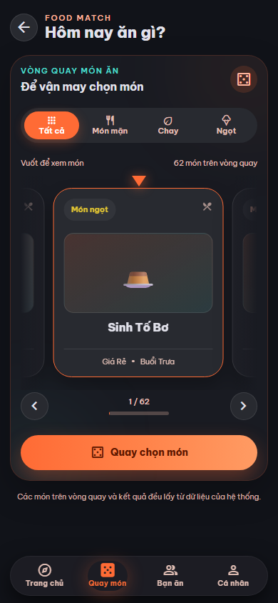
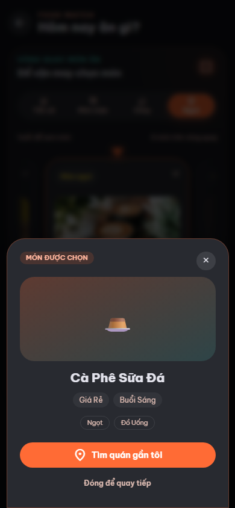
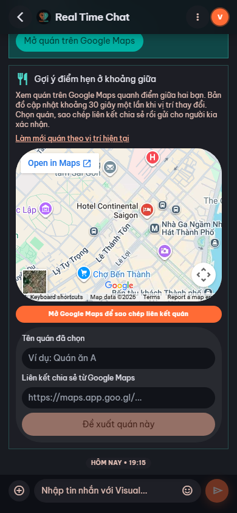
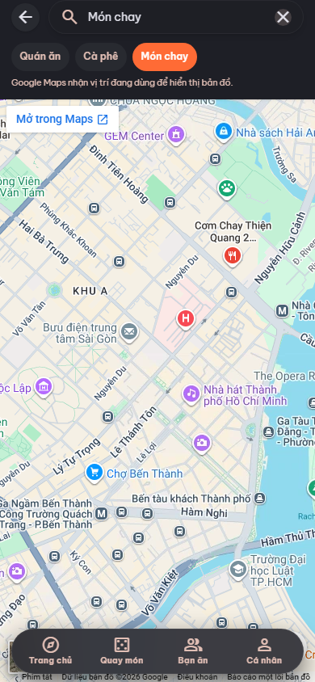
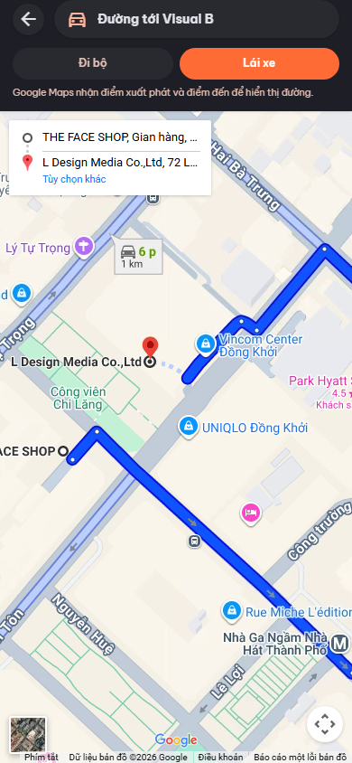

# Food Match

**Quay chọn món, lọc gợi ý và tìm bạn ăn ở gần.**

   

## Giới thiệu

Food Match là ứng dụng web hỗ trợ quyết định ăn gì và kết nối với người muốn ăn cùng ở gần. Người dùng có thể quay ngẫu nhiên trong danh sách món ăn, lọc gợi ý theo loại món, ngân sách, buổi ăn và khẩu vị. Ứng dụng dùng vị trí do trình duyệt cung cấp để tìm bạn ăn gần đó, đồng thời hiển thị bản đồ và chỉ đường bằng Google Maps nhúng. Hồ sơ người dùng là hồ sơ tạm, hết hạn sau 3 giờ kể từ khi tạo; backend lưu dữ liệu món ăn, lời mời ghép cặp và tin nhắn trong PostgreSQL.

## Ảnh chụp màn hình

Ảnh chụp từ Edge với viewport mô phỏng điện thoại 390×844 trên dữ liệu local ngày 21/10/2026; chưa thay cho kiểm thử trên điện thoại thật.







Maps Embed API với key thật ở localhost:5173, chụp ngày 23/10/2026:






Ảnh chụp desktop: chưa có.

## Tính năng chính

- Vòng quay món ăn với các bộ lọc Tất cả, Món mặn, Chay và Ngọt; ảnh riêng của món được ưu tiên khi dữ liệu có ảnh.
- Gợi ý món theo loại, khoảng giá, buổi ăn và tag khẩu vị.
- Tạo hồ sơ tạm, tìm người ăn trong 3 km và gửi lời mời ghép cặp; backend kiểm tra lại phạm vi khi gửi lời mời.
- Chat và thông báo ghép cặp theo thời gian thực qua SignalR.
- Trong cặp đã chấp nhận match, mỗi người có thể chia sẻ độc lập tọa độ chính xác của mình cho người kia, tối đa 60 phút mỗi lần bật. Người nhận thấy ngay tọa độ đó dù chưa chia sẻ lại; thu hồi của một người không tắt quyền chia sẻ của người còn lại. Tọa độ GPS từng người được giữ nguyên, không làm lệch. Khi **cả hai** còn chia sẻ, iframe Google Maps tìm quán quanh điểm giữa với mức zoom 15; nếu cấu hình Maps Embed API key, iframe dùng chế độ search chính thức của Google. Ứng dụng làm mới khoảng 30 giây một lần và có nút làm mới. Người dùng sao chép liên kết quán từ Google Maps để đề xuất, người kia xác nhận. Ứng dụng không đọc được danh sách hoặc quán được bấm trong iframe. Nút mở Google Maps cho phép xem danh sách kết quả trực tiếp trên Google. Nếu cấu hình Overpass riêng, ứng dụng còn hiển thị danh sách OSM để chọn nhanh. Đề xuất bị ẩn khi một bên thu hồi hoặc hết quyền chia sẻ.
- Tìm địa điểm theo từ khóa món/quán, xem bản đồ và chỉ đường bằng Google Maps nhúng.
- Giao diện tiếng Việt/tiếng Anh và bố cục dùng được trên điện thoại.

## Công nghệ sử dụng

Các phiên bản dưới đây lấy từ `frontend/package.json`, các file `.csproj` và `docker-compose.yml`; ký hiệu `^`/`~` là khoảng phiên bản khai báo.

| Công nghệ | Phiên bản | Mục đích |
| --- | --- | --- |
| React, React Router | `^19.0.0`, `^7.0.0` | Giao diện và điều hướng |
| TypeScript, Vite | `~5.7.0`, `^6.0.0` | Kiểm tra kiểu, dev server và đóng gói frontend |
| Tailwind CSS, Ant Design / Ant Design Mobile | `^4.3.3`, `^5.22.0` / `^5.43.0` | Giao diện và thành phần UI |
| Zustand, i18next | `^5.0.0`, `^24.0.0` | Trạng thái ứng dụng và đa ngôn ngữ |
| ASP.NET Core, Entity Framework Core, Npgsql | `net10.0`, `10.0.0`, `10.0.0` | API, truy cập và migration dữ liệu |
| SignalR | `@microsoft/signalr ^9.0.19`; hub trong ASP.NET Core 10 | Chat và thông báo ghép cặp thời gian thực |
| PostgreSQL | `16-alpine` trong Docker Compose | Lưu trữ dữ liệu |
| xUnit | `2.9.0` | Kiểm thử backend |

## Yêu cầu hệ thống

- Node.js và npm: đã kiểm chứng với Node.js `22.14.0`, npm `11.2.0`; dự án chưa khai báo phiên bản Node tối thiểu trong `package.json`.
- .NET 10 SDK để chạy backend. Bản làm việc hiện tại có SDK Windows tại `.dotnet/dotnet.exe`; bản clone khác có thể cần cài SDK riêng.
- PostgreSQL 16; có thể chạy bằng Docker Compose và Docker Desktop.
- Trình duyệt có hỗ trợ quyền vị trí nếu dùng tính năng tìm bạn ở gần hoặc bản đồ theo vị trí.

## Cài đặt

Thực hiện từ thư mục gốc của dự án. Chỉ tạo `.env` từ mẫu nếu file này chưa tồn tại, rồi cập nhật các giá trị cho máy của bạn, đặc biệt mật khẩu PostgreSQL và khóa JWT. Không đưa `.env` lên Git.

```powershell
if (-not (Test-Path .env)) { Copy-Item .env.example .env }
docker compose up -d postgres
cd frontend
npm install
```

`npm install` dùng `frontend/package-lock.json`. Backend sẽ tự chạy migration và seed dữ liệu món ăn khi khởi động; hãy kiểm tra cấu hình PostgreSQL trước khi chạy API.

## Cấu hình môi trường

Frontend đọc biến `VITE_*` từ `.env` ở thư mục gốc theo `vite.config.ts`. Backend cũng tìm và đọc file này khi chạy trong cây thư mục dự án. Cột “Mặc định” bên dưới là **giá trị mẫu trong `.env.example`**, không phải giá trị tự sinh nếu bạn chưa cấu hình.

| Biến | Ý nghĩa | Mặc định | Bắt buộc |
| --- | --- | --- | --- |
| `POSTGRES_DB` | Tên database của container PostgreSQL | `foodmatch` | Có, khi dùng Docker Compose |
| `POSTGRES_USER` | Người dùng PostgreSQL | `postgres` | Có, khi dùng Docker Compose |
| `POSTGRES_PASSWORD` | Mật khẩu PostgreSQL | `postgres`; cần đổi khi triển khai | Có, khi dùng Docker Compose |
| `ConnectionStrings__DefaultConnection` | Chuỗi kết nối backend tới PostgreSQL | `Host=localhost;Port=5432;Database=foodmatch;Username=postgres;Password=postgres` | Có |
| `JwtSettings__Secret` | Khóa ký JWT, tối thiểu 32 byte UTF-8 | Giá trị giữ chỗ, phải thay | Có |
| `JwtSettings__Issuer` | JWT issuer | `FoodMatchApi` | Có |
| `JwtSettings__Audience` | JWT audience | `FoodMatchClient` | Có |
| `Cors__Origins` | Origin frontend được phép, phân tách bằng dấu phẩy | `http://localhost:5173` | Có |
| `ASPNETCORE_URLS` | Địa chỉ backend lắng nghe | `http://localhost:5000` | Không |
| `ASPNETCORE_ENVIRONMENT` | Chế độ Development/Production | `Development` | Có khi chạy local không có Turnstile thật |
| `Turnstile__SecretKey`, `Turnstile__Hostname` | Xác minh CAPTCHA ở backend; hostname Production/staging chính xác, phân tách bằng dấu phẩy, không có `https://`, port hoặc wildcard | Rỗng khi Development | Có, khóa thật khi Production |
| `VITE_API_URL` | URL gốc backend, không thêm `/api` | `http://localhost:5000` | Có với frontend |
| `VITE_SIGNALR_URL` | URL gốc backend cho các hub SignalR | `http://localhost:5000` | Có với frontend |
| `VITE_FOOD_IMAGE_ORIGINS` | Origin HTTPS bổ sung cho ảnh món; dùng chung với CSP Vercel, phân tách bằng dấu phẩy | Rỗng; mặc định cho Unsplash/Wikimedia | Không |
| `VITE_TURNSTILE_SITE_KEY` | Khóa công khai widget CAPTCHA | Rỗng khi Development | Có khi Production |
| `GoogleMaps__EmbedApiKey` | Khóa công khai Maps Embed API cho cả backend và frontend, giới hạn theo API và HTTP referrer của site | Rỗng: iframe cũ; có khóa: `view`, `search`, `directions` chính thức | Có cho release; đặt ở cả Render và Vercel |
| `MeetingPlaces__OverpassUrl` | Nguồn Overpass riêng cho danh sách OSM bổ sung | Bỏ trống: chỉ dùng Google Maps ở mọi môi trường | Không; chỉ đặt endpoint HTTPS riêng đã duyệt, endpoint công khai mặc định bị từ chối |
| `STITCH_API_KEY`, `GITHUB_PERSONAL_ACCESS_TOKEN`, `VERCEL_API_TOKEN` | Có trong file mẫu nhưng mã nguồn hiện không đọc | Rỗng | Không |

## Chạy dự án

Mở các terminal riêng cho backend và frontend.

**Backend** — từ thư mục gốc, sau khi PostgreSQL đã sẵn sàng:

```powershell
cd backend/FoodMatch
& ..\..\.dotnet\dotnet.exe run --project .\src\FoodMatch.Api --no-launch-profile
```

Nếu máy đã cài .NET 10 SDK trong `PATH`, có thể dùng `dotnet` thay cho `& ..\..\.dotnet\dotnet.exe`. API theo cấu hình mẫu ở `http://localhost:5000/api`; kiểm tra database tại `http://localhost:5000/api/health`. Swagger chỉ được bật khi backend chạy trong môi trường Development.

**Frontend** — mở terminal khác từ thư mục gốc:

```powershell
cd frontend
npm run dev
```

Mở `http://localhost:5173`. Các lệnh frontend khác được khai báo trong `frontend/package.json`:

```bash
npm run build
npm run preview
npm run lint
```

`npm run build` tạo `frontend/dist/`; `npm run preview` phục vụ bản build để kiểm tra. `npm run lint` kiểm tra mã bằng ESLint. Frontend **không có** script `npm test` hoặc `npm run test`.

## Cấu trúc thư mục

```text
random_food/
├── .env.example              # Mẫu biến môi trường chung
├── docker-compose.yml         # PostgreSQL cho môi trường cục bộ
├── docs/screenshots/          # Ảnh kiểm tra vòng quay trên viewport điện thoại
├── scripts/                   # Smoke test API/SignalR và ảnh giao diện mobile
├── frontend/
│   ├── src/
│   │   ├── api/              # HTTP client và lời gọi API
│   │   ├── assert/           # Logo và ảnh nền của giao diện
│   │   ├── components/       # Thành phần giao diện dùng lại
│   │   ├── hooks/            # Vị trí và kết nối SignalR
│   │   ├── i18n/             # Bản dịch tiếng Việt và tiếng Anh
│   │   ├── pages/            # Các màn hình theo route
│   │   ├── stores/           # Trạng thái Zustand
│   │   ├── styles/           # CSS chung
│   │   ├── types/            # Kiểu dữ liệu TypeScript
│   │   └── utils/            # Hàm hỗ trợ và ảnh gợi ý
│   ├── package.json          # Script và phụ thuộc frontend
│   └── vite.config.ts        # Cấu hình Vite, dev port 5173
└── backend/FoodMatch/
    ├── src/
    │   ├── FoodMatch.Api/            # Controller, hub và cấu hình API
    │   ├── FoodMatch.Application/    # DTO, interface và dịch vụ
    │   ├── FoodMatch.Domain/         # Entity và enum
    │   └── FoodMatch.Infrastructure/ # EF Core, migration và seed
    ├── tests/FoodMatch.Tests/        # Unit test backend
    └── FoodMatch.sln                 # Solution .NET
```

Hiện chưa có thư mục `frontend/public/`; ảnh kiểm tra vòng quay trên viewport điện thoại ở `docs/screenshots/`.

## Kiểm thử

Frontend chưa có lệnh `npm test`; bài kiểm thử Edge nằm trong `scripts/capture-random-mobile.ps1`. Từ thư mục gốc, chạy bộ unit test xUnit của backend:

```powershell
cd backend/FoodMatch
& ..\..\.dotnet\dotnet.exe test FoodMatch.sln
```

Trên Windows có Edge, đặt `$env:FOODMATCH_VISUAL_PORT='5173'` rồi chạy `& .\scripts\capture-random-mobile.ps1` từ thư mục gốc để chụp vòng quay, kết quả, bản đồ, đường đi và điểm hẹn ở viewport 390×844 với key giới hạn cho localhost:5173. Script xác nhận GPS chính xác, điểm giữa thay đổi, thu hồi quyền chia sẻ và SignalR nối lại. Script mặc định dùng cổng 5174 nếu không đặt biến trên, dùng PostgreSQL thử riêng và không ghi đè các ảnh `*-mobile-preview.png` đã có ở thư mục gốc.

Trước deploy, thực hiện [quy trình kiểm tra trên hai điện thoại thật](docs/two-phone-acceptance.md) với bản staging HTTPS để xác nhận GPS, quyền chia sẻ độc lập, Google Maps, thu hồi và SignalR trên thiết bị thực.

Để kiểm tra nâng cấp database có dữ liệu chia sẻ cũ, chạy `& .\scripts\test-location-migration.ps1` từ thư mục gốc. Script tạo PostgreSQL thử riêng, nâng từ migration trước đó, xác nhận mốc 60 phút được giữ cho cặp đã đồng ý và trạng thái một phía cũ không rõ thời điểm bị đặt lại, rồi chạy toàn bộ test backend. Database thử được xóa sau khi chạy.

Kiểm chứng mới nhất ngày 23/10/2026: backend Release và migration nâng cấp trên PostgreSQL thử đạt **85/85 test, 0 skip**. Smoke SignalR độc lập đạt, Docker image build và health check trên database thử đạt. Edge 390×844 với key thật ở localhost:5173 đạt kiểm tra URL iframe chính thức, GPS chính xác, quyền chia sẻ và reconnect; ảnh Bản đồ, Đường đi và điểm hẹn được tạo. `npm ci`, lint, release build yêu cầu key, `check:vercel` với origin HTTPS mẫu và hai lệnh audit đều đạt. Bài thử hai điện thoại HTTPS, Turnstile thật và GitHub Actions vẫn cần thực hiện trước production.

Riêng verifier Turnstile đã đạt **15/15** trường hợp Production/Preview, domain ngoài danh sách và cấu hình sai; chưa dùng khóa Cloudflare thật. Frontend `npm ci`, lint, build và audit đã đạt ở lần kiểm tra ngày 22/10/2026. API dùng hạn mức 240 request/phút cho mỗi IP trên một instance, cộng với policy theo hồ sơ/endpoint; trên Render, IP lấy từ header `CF-Connecting-IP` do edge ghi đè. Cần xác nhận hai IP mạng thật và hành vi qua proxy trên staging.

Ngày 22/10/2026, frontend đã nâng lên Tailwind 4.3.3: cài sạch `npm ci`, lint, build và bài Edge 390×844 đều đạt; `npm audit --audit-level=high` và `npm audit --omit=dev` đều báo **0** lỗ hổng. Tailwind 4 cần Safari 16.4+, Chrome 111+ hoặc Firefox 128+; vẫn cần kiểm tra trên điện thoại mục tiêu. NuGet không báo gói dễ tổn thương ở lần kiểm tra trước. Xem [bản review trước phát hành](docs/release-review.md) để đối chiếu toàn bộ diff và các cổng còn thiếu.

## Triển khai

Maps Embed API hiện được dùng cho ba màn hình: Bản đồ (`view` và `search` với nút Quán ăn/Cà phê/Món chay), Đường đi (`directions` với Đi bộ/Lái xe) và gợi ý điểm hẹn trong Chat (`search` với Quán ăn/Cà phê/Món chay/Đồ ngọt). Tọa độ GPS không bị làm lệch. `GoogleMaps__EmbedApiKey` cần được cấu hình ở **cả Render và Vercel**; Vite chỉ đưa key này vào bundle công khai. Giới hạn key theo Maps Embed API và HTTP referrer chính xác của các domain frontend. Xem [phạm vi và cổng kiểm tra Maps Embed](docs/maps-embed-plan.md).

CI ở [Verify Food Match](.github/workflows/verify.yml) chạy khi push/PR; [run đầu của nhánh review](https://github.com/HungThichCodee/random_food/actions/runs/39984638973) đã đạt cả hai job. [Release Food Match](.github/workflows/release.yml) là CD thủ công: chọn staging hoặc production, chạy lại CI, chờ GitHub Environment duyệt rồi triển khai cùng commit lên Render và Vercel. Thiết lập biến và từng bước trong [hướng dẫn deploy](.claude/skills/deploy.md). Chỉ kết luận sẵn sàng production sau khi CI commit cuối và kiểm thử staging trên hai điện thoại thật đạt.

Build frontend trong thư mục `frontend` bằng `npm run build` và phục vụ các file trong `frontend/dist/` bằng máy chủ tĩnh có chuyển các route ứng dụng về `index.html`. Các biến `VITE_*` cần đúng **trước lúc build** vì Vite đưa chúng vào bundle. Backend có `backend/FoodMatch/src/FoodMatch.Api/Dockerfile` để build image ASP.NET Core 10; `docker-compose.yml` hiện chỉ khai báo PostgreSQL, chưa có service frontend/backend. Có thể kiểm tra image local bằng `docker build -f src/FoodMatch.Api/Dockerfile -t foodmatch-api:preflight .` từ `backend/FoodMatch`, rồi chạy `& .\scripts\smoke-docker-api.ps1` từ thư mục gốc khi PostgreSQL Docker đang hoạt động. Script tạo và xóa database thử riêng. Cấu hình PostgreSQL, JWT, CORS và địa chỉ lắng nghe cho môi trường triển khai; lưu secret ngoài Git. API chạy migration và seed lúc khởi động, nên cần quyền truy cập database phù hợp.

Quy trình cụ thể Supabase → Render → Vercel nằm trong [.claude/skills/deploy.md](.claude/skills/deploy.md). Verify chạy khi push/PR và được Release gọi lại. Release là CD thủ công cho staging/production, triển khai cùng SHA lên Render/Vercel sau GitHub Environment gate. [CI đầu tiên của nhánh review](https://github.com/HungThichCodee/random_food/actions/runs/39984638973) đã đạt cả frontend/backend; chưa deploy staging/production. Có thể bắt đầu quy trình staging sau khi duyệt bản review và CI commit cuối xanh; chỉ phát hành production khi hai điện thoại HTTPS, Turnstile, CSP/WSS, backup/rollback và rà chiến lược lưu phiên đạt.

## Xử lý sự cố thường gặp

- **`npm run lint` thất bại sau khi thêm mã mới:** sửa lỗi được ESLint báo trong frontend rồi chạy lại `npm run lint` và `npm run build`.
- **Trang báo thiếu `VITE_API_URL` hoặc `VITE_SIGNALR_URL`:** kiểm tra `.env` ở thư mục gốc và khởi động lại Vite sau khi sửa biến.
- **Backend báo lỗi kết nối PostgreSQL hoặc health check không đạt:** kiểm tra container `postgres`, các biến `POSTGRES_*` và `ConnectionStrings__DefaultConnection` có cùng thông tin đăng nhập.
- **Backend báo khóa JWT không hợp lệ:** đặt `JwtSettings__Secret` thành chuỗi ngẫu nhiên dài ít nhất 32 byte UTF-8.
- **Build có cảnh báo Rollup về `@microsoft/signalr` hoặc bundle trên 500 kB:** đó là cảnh báo đã quan sát; lần kiểm chứng này `npm run build` vẫn hoàn tất thành công.

## Đóng góp

Kho mã hiện chưa có `CONTRIBUTING.md`. Trước khi gửi thay đổi, hãy chạy `npm run lint` và `npm run build` ở frontend, cùng `dotnet test FoodMatch.sln` ở backend. TODO: cần xác nhận quy trình review và đóng góp của dự án.

## Giấy phép

Dự án dùng [giấy phép MIT](LICENSE), với dòng bản quyền năm 2026 theo tài khoản chủ kho mã `HungThichCodee`.

## Tác giả / Liên hệ

Kho mã và tài khoản chủ dự án: [HungThichCodee/random_food](https://github.com/HungThichCodee/random_food). Kênh liên hệ chính thức chưa được công bố trong README.
