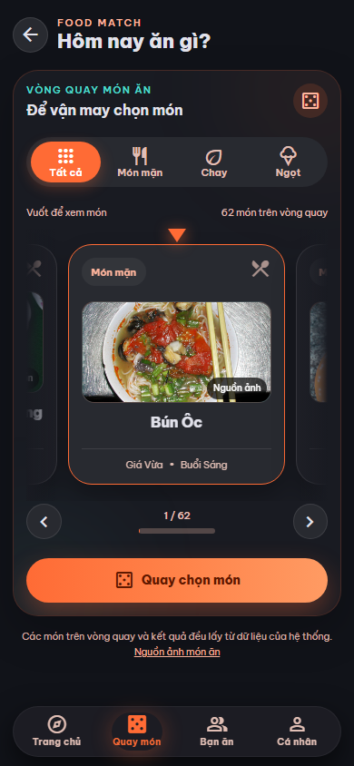
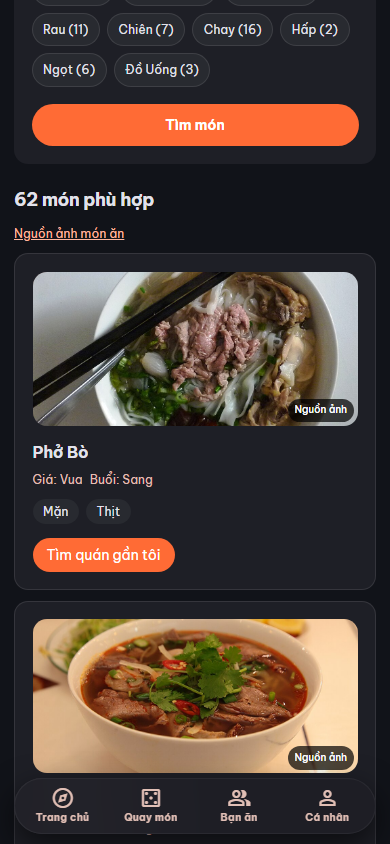
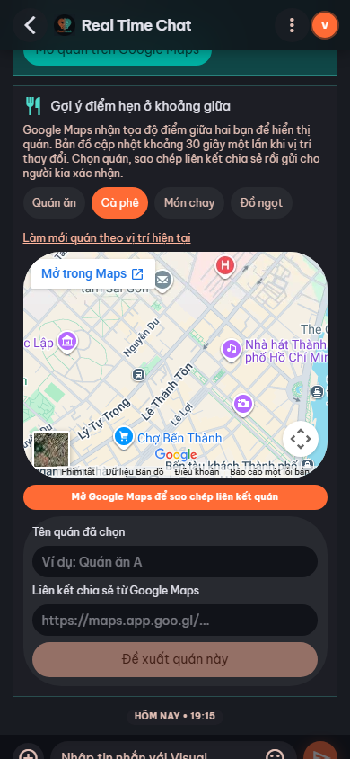
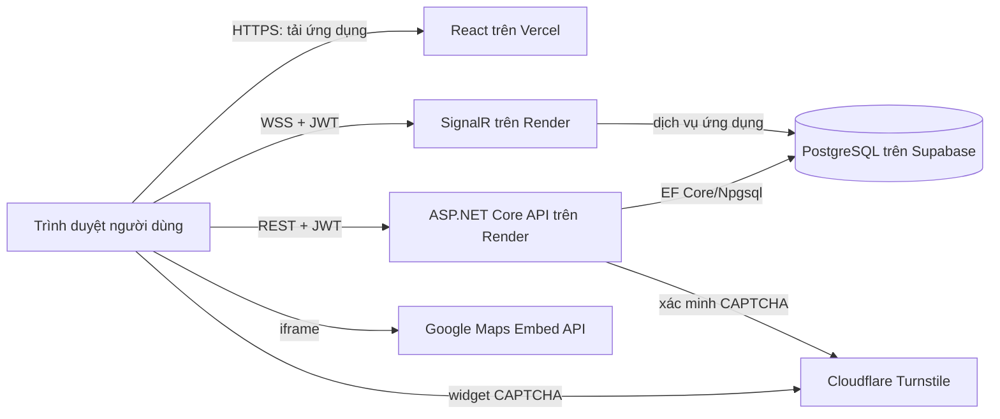
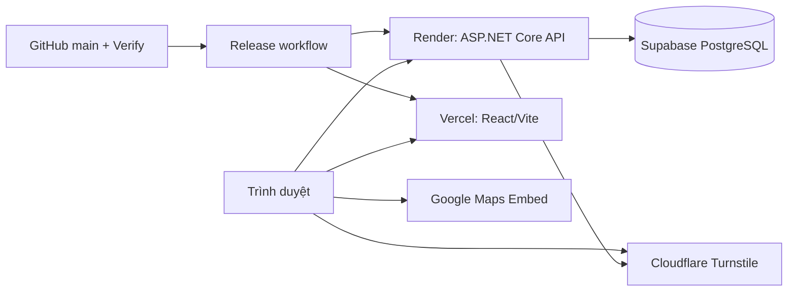

# Food Match

**Quay chọn món ăn, tìm bạn ăn gần mình và hẹn gặp trên bản đồ.**

[](https://github.com/HungThichCodee/random_food/actions/workflows/verify.yml)


[](LICENSE)

[Dùng thử](https://foodmatchh.vercel.app/) · [Bắt đầu nhanh](#quick-start) · [Tài liệu](#documentation) · [Mã nguồn](https://github.com/HungThichCodee/random_food)

## Mục lục

- [Overview](#overview) · [Screenshots](#screenshots) · [Features](#features) · [Technology stack](#technology-stack)
- [Architecture](#architecture) · [Quick start](#quick-start) · [Configuration](#configuration) · [Testing](#testing)
- [Deployment](#deployment) · [Security and privacy](#security-and-privacy) · [Documentation](#documentation) · [Troubleshooting](#troubleshooting) · [License and author](#license-and-author)

## Overview

Food Match giúp người chưa biết ăn gì chọn món bằng vòng quay hoặc bộ lọc, rồi tìm người muốn ăn cùng ở gần. Hồ sơ tạm giúp bắt đầu mà không cần tạo tài khoản mật khẩu.

Khi hai người ghép cặp, họ có thể nhắn tin, tự quyết định có chia sẻ vị trí hay không và cùng chọn điểm hẹn. Bản đồ Google được nhúng để tìm quán và xem đường đi. Ứng dụng chưa có đặt món hoặc thanh toán.

## Screenshots

Ảnh chụp từ bản local trên viewport điện thoại 390 × 844, ngày 23–24/10/2026. Đây là ảnh thật trong repository, không phải ảnh của mọi màn hình ở bản mới nhất.

<p align="center">
  
  
  
</p>

Chưa có ảnh chụp trong repository cho giao diện `/map` mới và desktop. Xem trực tiếp [Bản đồ & đường đi](https://foodmatchh.vercel.app/map).

## Features

- **Random món ăn:** vòng quay với bốn bộ lọc Tất cả, Món mặn, Chay, Ngọt; thẻ và kết quả dùng ảnh món.
- **Gợi ý món:** lọc theo loại món, giá, buổi ăn và tag khẩu vị.
- **Tìm bạn ăn chung:** hồ sơ tạm và danh sách người trong phạm vi 3 km. Danh sách chỉ hiển thị tín hiệu gần đúng, không trả tọa độ hoặc khoảng cách chi tiết.
- **Ghép cặp:** gửi và chấp nhận lời mời trước khi vào chat riêng.
- **Chat thời gian thực:** tin nhắn và cập nhật ghép cặp qua SignalR.
- **Chia sẻ vị trí:** mỗi người trong cặp đã match tự bật hoặc thu hồi quyền chia sẻ tọa độ chính xác của mình; mỗi lần chia sẻ có hiệu lực tối đa 60 phút. Người kia không phải chia sẻ lại để xem vị trí đã được cho phép.
- **Gợi ý điểm hẹn:** chỉ hiện khi cả hai còn chia sẻ. Google Maps tìm quán quanh điểm giữa; một người dán tên và liên kết quán để người kia kiểm tra, xác nhận. Danh sách OSM là tùy chọn khi có endpoint Overpass riêng.
- **Google Maps:** màn `/map` có Tìm quán, Đường đi và Phố 360°; sử dụng Maps Embed API khi có key. Ứng dụng không đọc được quán người dùng bấm trong iframe; có nút mở Google Maps để xem thêm.
- **Ngôn ngữ và giao diện:** có bản dịch Việt/Anh và nút đổi ngôn ngữ trên trang chủ; một số màn hình còn dùng tiếng Việt. Bố cục ưu tiên điện thoại.

## Technology stack

| Layer | Technology | Purpose |
| --- | --- | --- |
| Frontend | React `^19.0.0`, Vite `^6.0.0`, TypeScript `~5.7.0`, Tailwind CSS `^4.3.3` | Giao diện web |
| UI & state | Ant Design `^5.22.0`, Zustand `^5.0.0`, i18next `^24.0.0` | Thành phần UI, trạng thái, bản dịch |
| Backend | ASP.NET Core `net10.0`, EF Core/Npgsql `10.0.0` | REST API và truy cập dữ liệu |
| Database | PostgreSQL 16 trong Docker Compose; Supabase khi deploy | Hồ sơ, món ăn, match và chat |
| Realtime | SignalR trong ASP.NET Core; client `@microsoft/signalr ^9.0.19` | Tin nhắn và thông báo |
| Maps | Google Maps Embed API; Overpass tùy chọn | Bản đồ, chỉ đường và gợi ý điểm hẹn |
| Hosting & CI/CD | Vercel, Render, Supabase; GitHub Actions | Triển khai và xác minh |

Phiên bản frontend lấy từ [package.json](frontend/package.json), backend từ các file `.csproj`; các dấu `^`/`~` là khoảng phiên bản khai báo.

## Architecture



Sơ đồ thể hiện môi trường đã triển khai; khi chạy local, frontend, API và PostgreSQL chạy trên máy của bạn. Trình duyệt không truy cập trực tiếp database.

Mã giao diện ở `frontend/src/`, API ở `backend/FoodMatch/src/`, test .NET ở `backend/FoodMatch/tests/` và các script smoke ở `scripts/`.

## Quick start

Yêu cầu: Git, Node.js 22 + npm (phiên bản dùng trong CI), [.NET 10 SDK](https://dotnet.microsoft.com/download/dotnet/10.0) và Docker Desktop. Các lệnh sau dành cho **Windows PowerShell**; dùng `dotnet` trong `PATH`, không phụ thuộc thư mục SDK riêng của máy tác giả.

**1. Clone và cấu hình** trong terminal thứ nhất:

```powershell
git clone https://github.com/HungThichCodee/random_food.git
Set-Location .\random_food
if (-not (Test-Path .env)) { Copy-Item .env.example .env }
notepad .env
```

Trong `.env`, đặt mật khẩu PostgreSQL của bạn ở cả `POSTGRES_PASSWORD` và `ConnectionStrings__DefaultConnection`; thay `JwtSettings__Secret` bằng chuỗi ngẫu nhiên dài ít nhất 32 byte. Không commit file này.

**2. Khởi động PostgreSQL và backend** từ thư mục gốc:

```powershell
docker compose up -d postgres
dotnet run --project .\backend\FoodMatch\src\FoodMatch.Api --no-launch-profile
```

API dùng cấu hình mẫu tại `http://localhost:5000`, tự chạy EF migrations và seed lúc khởi động. Kiểm tra `http://localhost:5000/api/health` trả `Healthy`.

**3. Khởi động frontend** trong terminal PowerShell mới, từ thư mục gốc:

```powershell
Set-Location .\frontend
npm.cmd ci
npm.cmd run dev
```

Mở `http://localhost:5173`. Nếu muốn dùng bản đồ theo GPS, cho phép trình duyệt truy cập vị trí. Xem [hướng dẫn triển khai](.claude/skills/deploy.md) trước khi dùng dịch vụ thật.

## Configuration

Mẫu cấu hình nằm trong [.env.example](.env.example). Vite đọc `.env` ở **thư mục gốc** qua [vite.config.ts](frontend/vite.config.ts); backend cũng đọc file gốc khi chạy trong repository. Với hosting, đặt biến ở đúng dịch vụ.

| Nhóm | Biến chính | Nơi dùng |
| --- | --- | --- |
| Frontend công khai | `VITE_API_URL`, `VITE_SIGNALR_URL` | Vite/Vercel; origin API HTTPS khi deploy |
| Database | `POSTGRES_*`, `ConnectionStrings__DefaultConnection` | Docker Compose và backend/Render |
| Backend secrets | `JwtSettings__Secret`, `JwtSettings__Issuer`, `JwtSettings__Audience`, `Cors__Origins` | Backend/Render |
| Maps | `GoogleMaps__EmbedApiKey` | Render và Vercel; key xuất hiện trong iframe, phải giới hạn API/referrer |
| CAPTCHA | `Turnstile__SecretKey`, `Turnstile__Hostname`, `VITE_TURNSTILE_SITE_KEY` | Secret/hostname ở backend; site key ở frontend |
| SEO | `FOODMATCH_SEO_INDEXABLE`, `VITE_PUBLIC_ORIGIN`, `FOODMATCH_GOOGLE_SITE_VERIFICATION` | Vercel; chỉ bật lập chỉ mục với origin production chính thức |
| Tùy chọn | `MeetingPlaces__OverpassUrl`, `VITE_FOOD_IMAGE_ORIGINS` | Danh sách OSM riêng và nguồn ảnh bổ sung |

`GoogleMaps__EmbedApiKey` là key công khai có giới hạn; không đưa JWT secret, mật khẩu database hay Turnstile secret vào biến frontend. Xem [cấu hình deploy](.claude/skills/deploy.md) để biết biến bắt buộc của từng môi trường.

## Testing

Chạy từ thư mục gốc, trừ khi cột lệnh ghi rõ `frontend`. Các lệnh dưới đây là cách kiểm tra, không phải khẳng định chúng vừa được chạy trên máy của bạn.

| Phạm vi | Lệnh hoặc hướng dẫn |
| --- | --- |
| Frontend lint | `cd frontend; npm.cmd run lint` |
| Frontend production build | `cd frontend; npm.cmd run build` |
| Kiểm tra ảnh món | `cd frontend; npm.cmd run check:food-images` |
| Backend build/test | `dotnet build .\backend\FoodMatch\FoodMatch.sln -c Release`; `dotnet test .\backend\FoodMatch\FoodMatch.sln -c Release` |
| Integration/smoke | [Hướng dẫn và điều kiện PostgreSQL thử](.claude/skills/deploy.md) |
| Nghiệm thu thủ công | [Checklist hai điện thoại trên staging](docs/two-phone-acceptance.md) |
| CI | [Verify Food Match](.github/workflows/verify.yml): backend PostgreSQL 16, frontend lint/build/audit |

Frontend hiện không khai báo script `npm test`. Lịch sử kiểm thử có ngày và giới hạn riêng nằm trong [báo cáo audit](docs/audits/FOODMATCH_POST_DEPLOY_AUDIT.md); xem badge CI ở đầu trang để biết trạng thái nhánh `main` hiện tại.

## Deployment



Hướng dẫn dưới đây đủ để cấu hình các dịch vụ bên ngoài từ đầu. Dự án đã có repository và website production; nếu bạn đang cập nhật bản hiện có, **dùng lại đúng project/service đang chạy**. Tạo riêng một bộ **Supabase database + Render Web Service + Vercel project + GitHub Environment** cho `staging` và một bộ cho `production`; không dùng database production để thử staging. Các tên miền bên dưới là ví dụ đã dùng trong dự án, cần đối chiếu lại trong dashboard trước khi điền.

[Supabase](https://supabase.com/docs/guides/platform/billing-on-supabase), [Render](https://render.com/docs/free), [Vercel](https://vercel.com/docs/plans/hobby) và [Turnstile](https://developers.cloudflare.com/turnstile/plans/) có gói dùng miễn phí với giới hạn riêng; kiểm tra gói, quota và backup thực tế trước khi chọn cho production. [Maps Embed API](https://developers.google.com/maps/documentation/embed/usage-and-billing) hiện không tính phí theo lượt nhưng yêu cầu Google Cloud billing account. Các gói, giới hạn và chính sách có thể thay đổi.

### 1. Chuẩn bị GitHub và mã nguồn

Đăng nhập [repository GitHub](https://github.com/HungThichCodee/random_food). Khi triển khai mới, có thể clone bằng `git clone https://github.com/HungThichCodee/random_food.git`. Dùng nhánh review/PR để kiểm tra thay đổi, rồi đưa **đúng commit đã duyệt** lên `main`. Mở **Actions → [Verify Food Match](.github/workflows/verify.yml)** và xác nhận cả job `backend`, `frontend` xanh ở SHA đó. Workflow kiểm tra .NET 10/PostgreSQL 16 và frontend Node 22; [Release Food Match](.github/workflows/release.yml) sẽ chạy lại Verify trước khi deploy.

Không đưa `.env`, database password, JWT secret hoặc token vào Git. Chủ dự án giữ các file mới trong `docs/` trên máy; khi stage, chọn rõ file cần commit và xem `git diff --cached --name-only` trước khi push. `.gitignore` **không ngăn** các file `docs/` đã được Git theo dõi từ trước bị stage bởi `git add -A`.

### 2. Tạo PostgreSQL trong Supabase

1. Vào [Supabase Dashboard](https://supabase.com/dashboard) → **New project**. Chọn organization, region phù hợp và tạo project riêng cho từng môi trường. Đặt database password mạnh, lưu trong trình quản lý mật khẩu.
2. Mở project → **Connect → Session pooler** nếu Render cần IPv4. Sao chép **host, port, database và username đúng từ dashboard**, không tự đoán host theo region. [Session pooler](https://supabase.com/docs/guides/database/connecting-to-postgres) dùng port `5432`; Transaction pooler dùng port `6543` và có giới hạn khác. Với API ASP.NET Core/Npgsql chạy liên tục, dùng session mode là lựa chọn thực tế khi cần IPv4.
3. Chuyển thông tin sang chuỗi Npgsql và dán **chỉ vào Render** ở bước 5:

   ```text
   Host=<pooler-host>;Port=5432;Database=postgres;Username=postgres.<project-ref>;Password=<database-password>;SSL Mode=Require
   ```

4. Xác nhận bạn có backup và đã thử cách khôi phục **đúng project** trước production. [Supabase Backups](https://supabase.com/docs/guides/platform/backups) nêu rõ khác biệt theo gói; gói Free cần chủ động xuất dữ liệu. Backend tự chạy EF migration và seed khi khởi động, nên không chạy lại migration bằng SQL Editor. Sau deploy, xem Render log và bảng `__EFMigrationsHistory` trong Supabase để xác nhận.

### 3. Tạo Cloudflare Turnstile

1. Vào [Cloudflare Dashboard](https://dash.cloudflare.com/) → **Turnstile → Add widget**. Tạo widget riêng cho staging và production nếu muốn tách khóa. Trong **Hostname management**, khai báo hostname frontend chính xác, ví dụ `foodmatch-staging.vercel.app` hoặc `foodmatchh.vercel.app`; không ghi `https://`, port, path hay `*`. Xem [hướng dẫn tạo widget](https://developers.cloudflare.com/turnstile/get-started/widget-management/dashboard/) nếu giao diện thay đổi.
2. Sau khi tạo, lấy **Site Key** đưa vào Vercel `VITE_TURNSTILE_SITE_KEY`, còn **Secret Key** đưa vào Render `Turnstile__SecretKey`. Trên Render, đặt `Turnstile__Hostname` bằng đúng hostname của widget. Không đưa Secret Key vào Vercel hoặc GitHub Variables.
3. Sau khi frontend chạy, tạo hồ sơ tạm trên domain thật để thử CAPTCHA. Nếu lỗi, đối chiếu hostname trong widget, site key của đúng Vercel project và secret key của đúng Render service. Backend ở `ASPNETCORE_ENVIRONMENT=Production` yêu cầu key/hostname thật. [Cloudflare mô tả việc cấp hai key và xác minh token trên server](https://developers.cloudflare.com/turnstile/get-started/).

### 4. Tạo Google Maps Embed API key

Vào [Google Cloud Console](https://console.cloud.google.com/) → chọn/tạo project và bật billing → **APIs & Services → Library → Maps Embed API → Enable** → **Credentials → Create credentials → API key**. Trong key, chọn **Application restrictions: Websites (HTTP referrers)** và thêm cả origin lẫn đường dẫn cho mỗi domain, ví dụ `https://foodmatchh.vercel.app` và `https://foodmatchh.vercel.app/*` (làm tương tự cho staging). Chọn **API restrictions: Restrict key → Maps Embed API**. Nếu dùng key riêng cho mỗi môi trường, chỉ cho phép domain của môi trường đó. Dán key đã hạn chế vào `GoogleMaps__EmbedApiKey` ở **cả Render lẫn Vercel**. Release build yêu cầu key này; key xuất hiện trong URL iframe nên không phải server secret. Dự án không cần bật Places/Routes API cho chức năng iframe hiện tại. Xem [hướng dẫn key](https://developers.google.com/maps/documentation/embed/get-api-key) và [billing Maps Embed](https://developers.google.com/maps/documentation/embed/usage-and-billing).

### 5. Tạo Backend Web Service trên Render

Vào [Render Dashboard](https://dashboard.render.com/) → **New → Web Service → Connect GitHub** → chọn repository này, branch `main`, runtime **Docker**. Dùng đúng cấu hình:

| Trường Render | Giá trị |
| --- | --- |
| Root Directory | `backend/FoodMatch` |
| Dockerfile Path | `src/FoodMatch.Api/Dockerfile` (tính từ Root Directory) |
| Docker Context | `.` (tính từ Root Directory) |
| Health Check Path | `/api/health` |
| Auto-Deploy | `Off` trước các push tiếp theo; Release workflow sẽ gọi deploy |

[`Dockerfile`](backend/FoodMatch/src/FoodMatch.Api/Dockerfile) dùng SDK/runtime .NET **10.0**, publish API và có entrypoint sẵn; không cần tự nhập lệnh build/start cho Docker. Tạo service có thể kích hoạt **lần deploy đầu tiên**. Trong service → **Environment**, thêm:

| Key Render | Giá trị và nguồn |
| --- | --- |
| `ASPNETCORE_ENVIRONMENT` | `Production` ở cả staging và production để bật kiểm tra production |
| `ASPNETCORE_URLS` | `http://0.0.0.0:8080` để container nhận request |
| `PORT` | `8080` nếu Render yêu cầu khai báo cổng rõ ràng; mã API đọc `ASPNETCORE_URLS` |
| `ConnectionStrings__DefaultConnection` | Chuỗi Npgsql của **đúng Supabase project** ở bước 2 |
| `JwtSettings__Secret` | Chuỗi ngẫu nhiên **ít nhất 32 byte**, khác giá trị mẫu và được giữ kín |
| `JwtSettings__Issuer` / `JwtSettings__Audience` | Ví dụ `FoodMatchApi` / `FoodMatchClient`; giữ nhất quán trong từng service |
| `Cors__Origins` | Origin Vercel chính xác, ví dụ `https://foodmatchh.vercel.app`; không có path, wildcard, dấu `/` cuối. Nhiều origin thì ngăn bằng dấu phẩy |
| `Turnstile__SecretKey` / `Turnstile__Hostname` | Secret Key / hostname Cloudflare ở bước 3 |
| `GoogleMaps__EmbedApiKey` | Maps Embed key đã giới hạn ở bước 4; dùng cho iframe trong Chat |

`MeetingPlaces__OverpassUrl` chỉ dùng nếu bạn có endpoint HTTPS riêng cho danh sách OSM; **để trống khi dùng Google Maps iframe**. `POSTGRES_*` trong `docker-compose.yml` chỉ dành cho PostgreSQL local. Render nhận HTTPS công khai và chuyển tiếp HTTP đến container.

Sau lần deploy, xem **Render → service → Events/Logs**: Docker build và startup thành công, log migration/seed thành công. Mở `https://<api-domain>/api/health`; JSON cần có `status: Healthy` và dependency PostgreSQL `Healthy`. Ghi **URL API** và **Service ID** (`srv-...`, ở Settings) cho bước GitHub. CORS và SignalR/WSS cần thử tiếp trên frontend thật.

### 6. Tạo Frontend project trên Vercel

Vào [Vercel Dashboard](https://vercel.com/dashboard) → **Add New → Project → Import Git Repository** → chọn repository này. Tạo project riêng cho staging và production, hoặc dùng lại project hiện có. Cấu hình:

| Trường Vercel | Giá trị |
| --- | --- |
| Root Directory | `frontend` |
| Framework Preset | Vite |
| Node.js Version | 22.x nếu project cho chọn; khớp Verify workflow |
| Install Command | `npm ci` |
| Build Command | `npm run build` |
| Output Directory | `dist` |

Project dùng [`frontend/vercel.mjs`](frontend/vercel.mjs) để tạo SPA rewrites, CSP/security headers và tắt Git auto deployment. **Không thêm `vercel.json` thứ hai.** Vào **Project → Settings → Environment Variables**, chọn scope **Production** cho cả Vercel project staging lẫn production: [Release workflow](.github/workflows/release.yml) dùng `vercel pull --environment=production`, `vercel build --prod`, `vercel deploy --prebuilt --prod` cho cả hai.

| Key Vercel | Staging | Production |
| --- | --- | --- |
| `VITE_API_URL` | Origin Render staging HTTPS | Origin Render production HTTPS |
| `VITE_SIGNALR_URL` | Origin Render staging HTTPS | Origin Render production HTTPS |
| `VITE_TURNSTILE_SITE_KEY` | Site Key Cloudflare staging | Site Key Cloudflare production |
| `GoogleMaps__EmbedApiKey` | Key Maps Embed giới hạn staging | Key Maps Embed giới hạn production |
| `FOODMATCH_SEO_INDEXABLE` | `0` | `1` |
| `VITE_PUBLIC_ORIGIN` | Để trống | Origin production chính thức, ví dụ `https://foodmatchh.vercel.app` |
| `FOODMATCH_GOOGLE_SITE_VERIFICATION` | Để trống | Tùy chọn: chỉ chuỗi `content` của thẻ xác minh Search Console |

Hai biến `VITE_*_URL` phải là **origin HTTPS**, không thêm `/api`, `/hubs`, path hoặc dấu `/` cuối; mã tự nối đường dẫn API/hub. Nếu giao diện Vercel hỏi **Config hay Secret**, các biến frontend trong bảng phải là giá trị đọc được để Release CLI build; JWT/DB/Turnstile Secret tuyệt đối không đặt ở Vercel. `VITE_FOOD_IMAGE_ORIGINS` tùy chọn nếu dùng CDN ảnh bổ sung. Thay biến build-time phải chạy **deployment mới**, chỉ Save không cập nhật bundle đã phát hành.

Trong **Project → Settings → Domains**, lấy domain cố định. Đưa origin đó vào Render `Cors__Origins`, hostname vào Render `Turnstile__Hostname` và Cloudflare widget; xác nhận Render đã chạy với cấu hình mới. Lấy **Project ID** (`prj_...`) ở Vercel Project Settings → General và **Team/Org ID** ở Vercel Team/Account Settings → General. Thử HTTPS, tải lại trực tiếp `/random`, `/map`, `/route`; các route không được trả 404.

### 7. Cấu hình GitHub Environments và chạy Release

Trong repository GitHub → **Settings → Environments**, tạo `staging` và `production`; giới hạn branch triển khai là `main`. Bật **Required reviewers** cho production nếu gói/quyền repository hỗ trợ, rồi kiểm tra bảo vệ thực sự có hiệu lực. [GitHub Environments](https://docs.github.com/en/actions/concepts/workflows-and-actions/deployment-environments) giữ secrets/variables riêng cho từng target; workflow không tự tạo người duyệt.

Trong **mỗi** environment, thêm đúng hai **Secrets** và năm **Variables** mà [release.yml](.github/workflows/release.yml) đọc:

| Loại | Tên | Lấy ở đâu, dán giá trị nào |
| --- | --- | --- |
| Secret | `RENDER_API_KEY` | Render Account Settings → API Keys; token có quyền deploy service |
| Secret | `VERCEL_TOKEN` | Vercel Account Settings → Tokens; token có quyền deploy project |
| Variable | `RENDER_SERVICE_ID` | Render service → Settings; ID dạng `srv-...` |
| Variable | `API_ORIGIN` | URL Render cố định, ví dụ `https://foodmatch-api-staging.onrender.com` |
| Variable | `VERCEL_ORG_ID` | Vercel Team/Account Settings → General |
| Variable | `VERCEL_PROJECT_ID` | Vercel Project Settings → General; ID dạng `prj_...` |
| Variable | `WEB_ORIGIN` | URL Vercel cố định, ví dụ `https://foodmatchh.vercel.app` |

`API_ORIGIN` và `WEB_ORIGIN` không có path hoặc dấu `/` cuối. Không dán Render/Vercel token vào Variables hay Vercel frontend. Đối chiếu mọi ID với **đúng môi trường** trước khi chạy. GitHub Release chỉ deploy từ `main` và dùng cùng commit SHA cho Render/Vercel.

1. Mở **Actions → Verify Food Match** và xác nhận hai job xanh trên commit `main` dự định triển khai.
2. Mở **Actions → Release Food Match → Run workflow** → branch `main`, target `staging`. Workflow chạy lại Verify, deploy Render đúng SHA, đợi API Healthy, build/deploy Vercel và kiểm tra hash HTML trên domain cố định.
3. Nghiệm thu staging trên hai điện thoại: Turnstile, Maps, GPS, match/chat, chia sẻ/thu hồi vị trí độc lập và WSS/nối mạng. Staging phải có header `X-Robots-Tag: noindex, nofollow`.
4. Sau khi staging đạt và đã xác nhận backup, chạy **cùng commit** với target `production`; chờ phê duyệt GitHub Environment nếu đã bật. Mở Render/Vercel logs và kiểm tra lại toàn bộ chức năng trên production.

**Kiểm tra sau production:** `/api/health` Healthy; trang chủ, `/random`, `/map` tải HTTPS; Maps không báo 403, Turnstile tạo hồ sơ được, SignalR kết nối WSS, hai điện thoại match/chat và thu hồi vị trí đúng. Kiểm tra `robots.txt`, `sitemap.xml`, canonical ở đúng domain; staging không được index. Không đưa secret server vào bundle hoặc log công khai.

**Cập nhật:** review diff → Verify → đưa commit đã duyệt lên `main` → Release staging → nghiệm thu → Release production cùng SHA. **Sự cố:** dừng phát hành, đối chiếu Render/Vercel deployment cũ và backup trước khi rollback; Vercel có [rollback deployment](https://vercel.com/docs/deployments/rollback-production-deployment), Render có [lịch sử deploy](https://render.com/docs/deploys). Rollback mã **không tự rollback EF migration** hoặc dữ liệu phát sinh sau backup. Xem [quy trình release nội bộ](.claude/skills/deploy.md) để biết thêm cổng kiểm thử.

## Security and privacy

- Hồ sơ tạm dùng JWT; `JwtSettings__Secret` và chuỗi kết nối chỉ ở backend. Hồ sơ hết hạn sau 3 giờ kể từ khi tạo; tác vụ dọn dữ liệu hết hạn chạy định kỳ 10 phút.
- API giới hạn CORS theo origin, xác minh Cloudflare Turnstile khi tạo hồ sơ ở production và áp dụng rate limiting. Rate limiter hiện lưu trong bộ nhớ mỗi instance.
- Danh sách người gần chỉ trả tín hiệu trong 3 km. Trong cặp đã match, mỗi người chia sẻ tọa độ chính xác độc lập tối đa 60 phút và có thể thu hồi; điểm hẹn cần cả hai còn chia sẻ.
- Maps Embed key hiện trong trình duyệt nên phải giới hạn **Maps Embed API** và HTTP referrer. Google Maps iframe không cung cấp danh sách quán được bấm cho ứng dụng.
- Các route riêng có `noindex`; cài đặt này không thay thế xác thực hoặc phân quyền. Xem [đánh giá bảo mật và SEO](docs/security-seo-review-2026-10-25.md).
- Ảnh món có nguồn và quyền sử dụng riêng trong [food-image-credits.md](docs/food-image-credits.md); giấy phép MIT của mã nguồn không tự cấp quyền tái sử dụng mọi ảnh.

## Documentation

- [Quy trình deploy Supabase → Render → Vercel](.claude/skills/deploy.md)
- [Nghiệm thu trên hai điện thoại](docs/two-phone-acceptance.md)
- [Phạm vi Google Maps Embed](docs/maps-embed-plan.md)
- [Nguồn và quyền sử dụng ảnh món](docs/food-image-credits.md)
- [Audit bảo mật, SEO](docs/security-seo-review-2026-10-25.md) và [audit sau deploy](docs/audits/FOODMATCH_POST_DEPLOY_AUDIT.md) — bằng chứng lịch sử theo ngày ghi trong từng tài liệu

Khi thay ảnh seed, cập nhật `frontend/food-images.manifest.json`; ảnh do chủ dự án cung cấp phải là PNG đúng tên slug trong `frontend/public/food-images/` và có trường `provided`. Chạy `node frontend/scripts/sync-food-images.mjs --only "Tên món"` hoặc `--provided`, rồi `cd frontend; npm.cmd run check:food-images` để kiểm tra danh mục và nguồn ảnh.

## Troubleshooting

- **Database không kết nối:** kiểm tra `docker compose ps`, `POSTGRES_*` và chuỗi kết nối có cùng mật khẩu. Docker volume cũ có thể vẫn giữ mật khẩu của lần khởi tạo trước.
- **Frontend không gọi được API:** đối chiếu `VITE_API_URL`/`VITE_SIGNALR_URL` với API đang chạy; khởi động lại Vite sau khi sửa `.env`.
- **Lỗi CORS:** thêm đúng origin frontend vào `Cors__Origins` của backend; không thêm path hay dấu `/` cuối.
- **Maps iframe trống hoặc báo 403:** kiểm tra key Maps Embed, API restriction và website referrer của đúng domain; xem Console/Network để phân biệt lỗi key với lỗi quyền GPS.
- **Chat/SignalR không kết nối:** kiểm tra API, `VITE_SIGNALR_URL`, kết nối WebSocket và hạn dùng hồ sơ/JWT.
- **Thiếu biến môi trường:** đối chiếu tên biến với [.env.example](.env.example); production còn yêu cầu Turnstile, URL HTTPS và key Maps Embed theo [deploy guide](.claude/skills/deploy.md).
- **Build thất bại:** chạy lại lệnh lint/build/test ở trên và đọc lỗi đầu tiên; sửa cấu hình hoặc mã theo đúng lỗi được báo.

## License and author

Mã nguồn dùng [MIT License](LICENSE), bản quyền 2026 [HungThichCodee](https://github.com/HungThichCodee). Ảnh món có quyền sử dụng riêng; xem [ghi nhận nguồn ảnh](docs/food-image-credits.md).
